# METRONOME for the M-VAVE FM-1

A stage metronome for the [M-VAVE FM-1](https://www.m-vave.com/), built on
[fm1-base](https://github.com/charlesvestal/fm1-base). Sixteen songs on the white keys, each with its own tempo,
meter, step pattern and sound; press a key and the next song starts at the next bar. GPL-3.0-or-later.

**[The setlist editor](https://daviddwlee84.github.io/fm1-metronome/web/)**: plan the 16 songs in the browser,
hear them, save them as a file, and send them to the FM-1 over USB (Chrome or Edge; editing and files work in any
browser). No FM-1 at hand? **[Try it in the browser](https://daviddwlee84.github.io/fm1-metronome/web/try/)** (the
[fm1-emu](https://github.com/joakimeriksson/fm1-emu) emulator). Every page and control on one sheet:
**[cheatsheet](https://daviddwlee84.github.io/fm1-metronome/web/cheatsheet.html)**. Playing along (0.4):
**[live](https://daviddwlee84.github.io/fm1-metronome/web/live/)**, a conductor beating the song's meter, the clicks
from the computer, and the transport, over USB or Bluetooth.

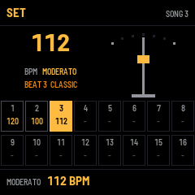

## How it is laid out

- **SET is the stage page.** Pick songs, see and change the tempo; little else to touch, so little to get wrong
  mid-song. The tempo's classical marking (LARGO, ANDANTE, ALLEGRO …) shows beside the BPM.
- **`HOME` goes one level down**, to the song's own page. Each song is one of two kinds (`SEL` switches):
  - **GRID**, detailed: every step of the bar on the white keys (off, ghost, normal, accent; the key is as bright
    as it sounds), beats a bar, a beat in quarters, eighths, triplets or sixteenths, and meter presets (6/8,
    6/8 in 6, 9/8, 12/8, 5/8 3+2, 7/8 2+2+3 …).
  - **CLASSIC**, quick: the rhythm-watch way, four volumes (quarter, eighth, triplet, sixteenth) mixed on `K1`–`K4`
    and an accent every 1–9 beats. Enough for practice without ever leaving the page.
- After a show, clear the set for the next one: `REC`, hold `SEL` 2 s, `PLAY`.

## Controls

| Control | Everywhere |
|---|---|
| `PLAY` | start / stop |
| `HOME` | SET ⇄ the song's GRID or CLASSIC page |
| `SELECT` | tempo ±1 (30–300); turned fast, ±5 a click |
| `ALGO` | the song's sound: CLICK, WOOD, BEEP (0.5: SET EDIT's `K3` can set one for every song) |
| black keys | tap tempo; they flash with the beat. On SET while playing they do nothing (a stray touch on stage) |

| Page | Controls |
|---|---|
| SET | white key: play that song (while playing: at the next bar, the key blinks until then); `OCT-` / `OCT+` tempo ±5; `K1` switch songs at the NEXT BAR or NOW; `K2` jump to the next tempo marking; `REC` EDIT |
| SET: EDIT | white key: pick it (an empty one starts as a copy), press it again on the beat to tap its tempo; `SEL` + key: clear it; `SEL` held 2 s: CLEAR ALL? (`PLAY` yes); `K3` one sound for every song (0.5: OWN, CLICK, WOOD, BEEP; the songs keep their own); `K4` Bluetooth on / off (0.5: the footer shows both in turn); `REC` leave |
| GRID | white key: a step's level; `K1` beats 1–9; `K2` a beat in quarters / 8ths / triplets / 16ths; `K3` meter presets; `OCT±` tempo ±5; `REC` tap tempo; `SEL` CLASSIC |
| CLASSIC | `K1`–`K4` the four layers' volumes 0–7; `OCT-` / `OCT+` an accent every 1–9 beats (0 none); any key or `REC` tap tempo; `SEL` GRID |

In triplets the meter reads as a compound one (two beats of three is 6/8) and the **BPM is the dotted quarter's**:
a chart's "eighth = 120" is 40 here. The presets 6/8 IN 6, 5/8 and 7/8 count the eighth instead.

Any question on the screen (CLEAR ALL?, a setlist from the computer) is answered by `PLAY` (yes); a setlist waits
for `PLAY` or `HOME` and ignores every other key.

## The setlist on a computer

METRONOME 0.3 and later talk to a computer over USB, 0.4 over Bluetooth too (SysEx, see `app.c`):

- **[The setlist editor](https://daviddwlee84.github.io/fm1-metronome/web/)** (or `web/index.html` from this
  repository, opened from your disk): *Read from the FM-1*, edit, *Send to the FM-1*. Or plan without the FM-1 and
  *Save file*: a phone works for that, sending needs Chrome or Edge on a computer (Safari has no Web MIDI).
- **The command line** (`host/`, Python with `mido` and `python-rtmidi`):

  ```sh
  PYTHONPATH=host python -m fm1_metronome backup setlist.json
  PYTHONPATH=host python -m fm1_metronome restore setlist.json
  ```

The file is plain JSON: the stored songs by key, each with its tempo, sound, GRID steps (`. g N A` for off, ghost,
normal, accent) and CLASSIC mix. The FM-1 shows how many songs arrived and loads them only after `PLAY`.
METRONOME 0.4 does the same over Bluetooth (`SET EDIT`, `K4`: on by default), with *Over Bluetooth* on the page.

## Playing along (0.4)

**[The live page](https://daviddwlee84.github.io/fm1-metronome/web/live/)** follows the FM-1 over USB or Bluetooth:

- a conductor beating the song's meter (6/8 in 2, 12/8 in 4, 5/8 3+2 long and short, 7/8 2+2+3 in 3, CLASSIC by its
  accent), the tempo, its marking, the bar and the beat;
- *Start*, *Stop*, the 16 songs (a press there is a press on the FM-1's key), the tempo;
- *Clicks from this computer*: the page sounds them, the FM-1 falls silent (`MUTE` on its header) until the page lets
  go. If the computer goes (the cable out, the page closed, Bluetooth lost), the FM-1 sounds again by itself: a
  stage never goes quiet because of the computer.

The FM-1 does not send a message a beat. It says what plays and when (a STATE: the song, a tick and the sample it
sounds at, the tempo) when that changes and once a second, and the page counts the beats on its own clock, so USB's
jitter (a few ms) and Bluetooth's (tens of ms, in bunches) never reach the beat. What is left is a fixed delay:
*Tap along to calibrate* on the page takes it out. From 0.5 the page also times a round trip each second (PING,
answered at once by PONG with the FM-1's clock) and sets its clock by it, as NTP does, so the link's own delay comes
out as well and less is left to calibrate. `python -m fm1_metronome watch` prints the STATEs and the round trips.

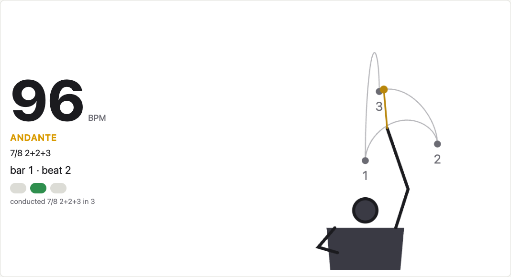

## Screens

From fm1-base's host simulator (`tests/basic.txt`).

| | | |
|---|---|---|
| 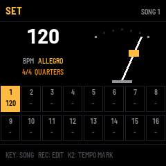 SET, playing |  `K2`: a tempo marking | 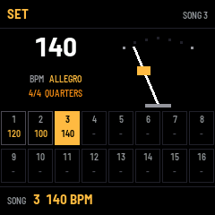 the next song waits for the bar |
| 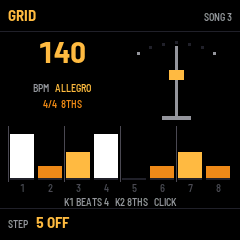 GRID, 4/4 eighths | 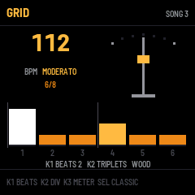 GRID 6/8 | 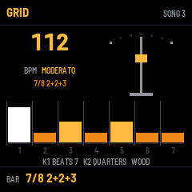 `K3`: 7/8 2+2+3 |
| 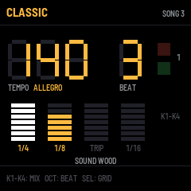 CLASSIC | 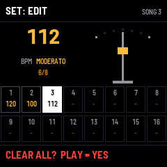 CLEAR ALL? | 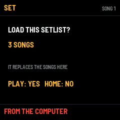 a setlist from the computer |
| 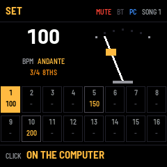 the page sounds the clicks (0.4) | 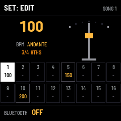 `K4`: Bluetooth off | 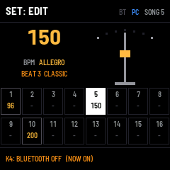 EDIT's footer: where Bluetooth is (0.5) |
| 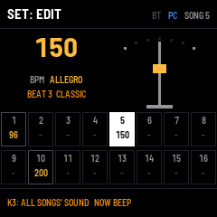 `K3`: one sound for every song (0.5) | 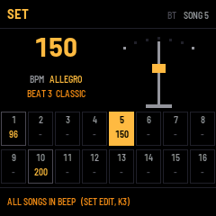 on stage, SET says so | 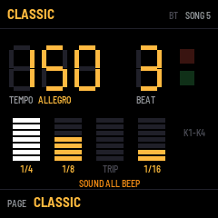 a song's page: `ALL BEEP` |

## Install

Back up your FM-1's flash first ([M-Flasher](https://github.com/jvitkauskas/m-flasher)).

- From [The Firmware Hub](https://thefirmwarehub.com/firmware/metronome/): install it from the browser over USB
  (Chrome or Edge); each new release shows up there by itself.
- From a release: download `metronome-X.Y.fwsc` from
  [Releases](https://github.com/daviddwlee84/fm1-metronome/releases) and install it with M-Flasher, or over
  USB-MIDI with fm1-base's `tools/fm1_install.py metronome-X.Y.fwsc`.
- The package carries fm1-base's update loader, so another firmware can be installed from METRONOME the usual way.
- Flash chips: it saves to and updates on both the first FM-1s' (`856014`) and the newer ones' (`B36014`) in the
  emulator; tested on a unit with the newer chip.

## Other firmwares' data

METRONOME does not read other firmwares' projects or samples. It keeps one record, its settings and the 16 songs
(460 bytes), at `0xCE000`-`0xCFFFF`, written a few seconds after a change. On Felucca-family firmwares (SLOOP and
others) that range is inside the area for samples: if you keep many samples there, back up before switching. It
writes nothing else outside its own firmware area and does not touch the global settings at `0xFC000`. (An update
to another firmware, as with every fm1-base firmware, stages its loader at `0xE0000`.)

## Build

```sh
git clone --recursive https://github.com/daviddwlee84/fm1-metronome
cd fm1-metronome
python3 fm1-base/tools/build.py . --host          # the host simulator (see fm1-base's README for its tools)
cd build/host && ./metronome_host ../../tests/basic.txt . && cd ../..
cc -std=c99 -Wall -Wextra -o /tmp/metro_test tests/metro_test.c && /tmp/metro_test   # the platform-free core
PYTHONPATH=host python -m pytest -q host/tests     # the computer side (frames shared with tests/basic.txt)
node web/tests/setlist_test.js                     # the web page's setlist.js (the same frames)
node web/tests/live_test.js                        # the live link, the conductor, Bluetooth's packets
python3 fm1-base/tools/build.py .                  # the device package (JieLi toolchain: fm1-base's README)
```

| File | What |
|---|---|
| `metro.c` | platform-free: what sounds on each tick (GRID's steps, CLASSIC's layers), tap tempo, tempo markings, meter presets |
| `app.c` | the pages, input, LEDs, the click synth on its exact sample, storage, the setlist and the live link (USB, Bluetooth) |
| `common/` | hostlink (SysEx with a host) and ledfx (LED patterns), MIT |
| `tests/` | `metro_test.c` for the core, `basic.txt` for fm1-base's host simulator |
| `host/` | `fm1_metronome`: the setlist to a JSON file and back (Python), with its tests |
| `web/` | `index.html` (the setlist editor), `live/` (playing along), `setlist.js` (the wire and the file), `link.js` (USB and Bluetooth), `live.js` (the live link's timing), `conductor.js`, all tested in `web/tests/`; `cheatsheet.html`, `try/` (fm1-emu), `words/` (the screen reader's words) |
| `docs/` | `screen.png` (the Hub's card), `screens/` (this page) |

Design notes (Traditional Chinese) and development live in
[M-VAVE_FM-1](https://github.com/daviddwlee84/M-VAVE_FM-1) (`docs/dev/metronome.md`), which has this repository as
a submodule.

## License

GPL-3.0-or-later (see `LICENSE`); `common/` is MIT. Built on fm1-base (MPL-2.0). Not made by M-VAVE.
